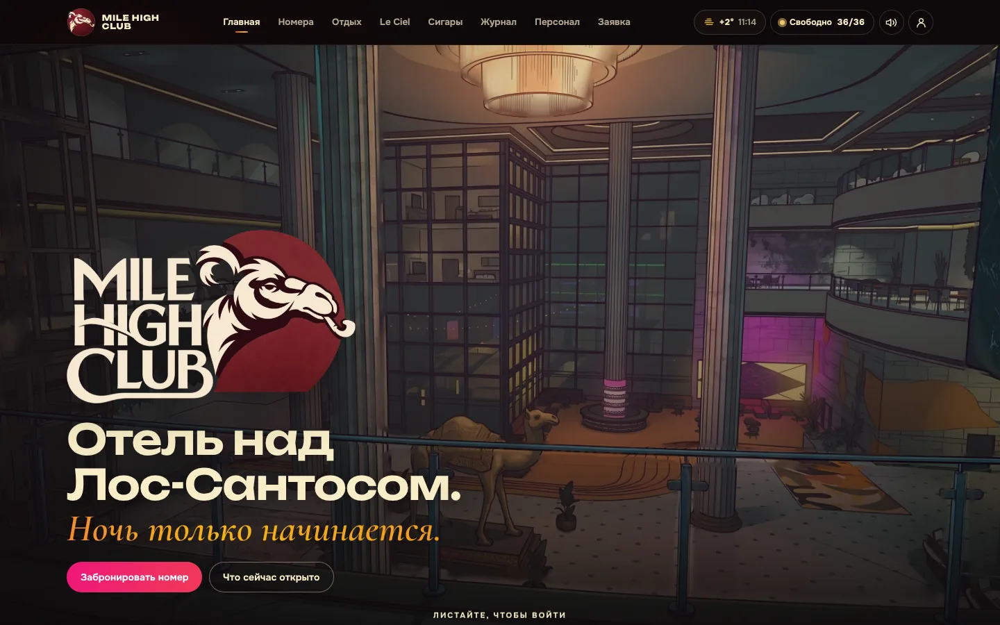
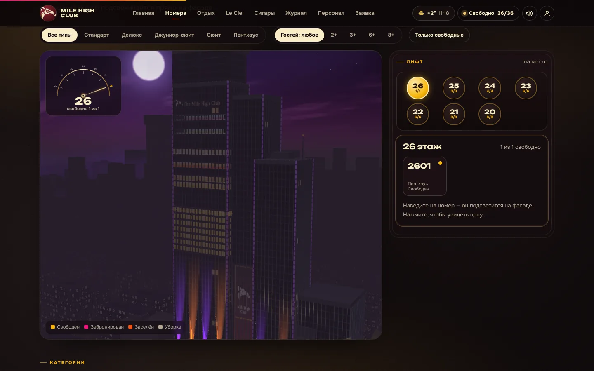
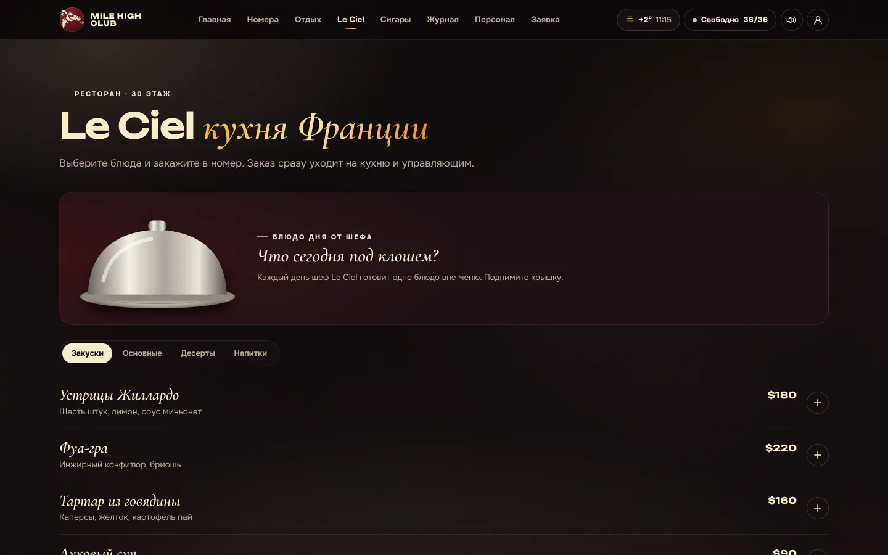
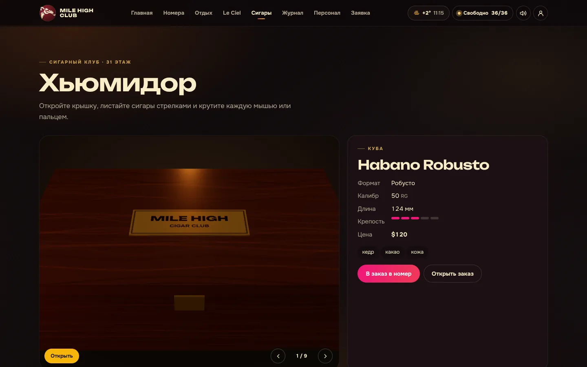
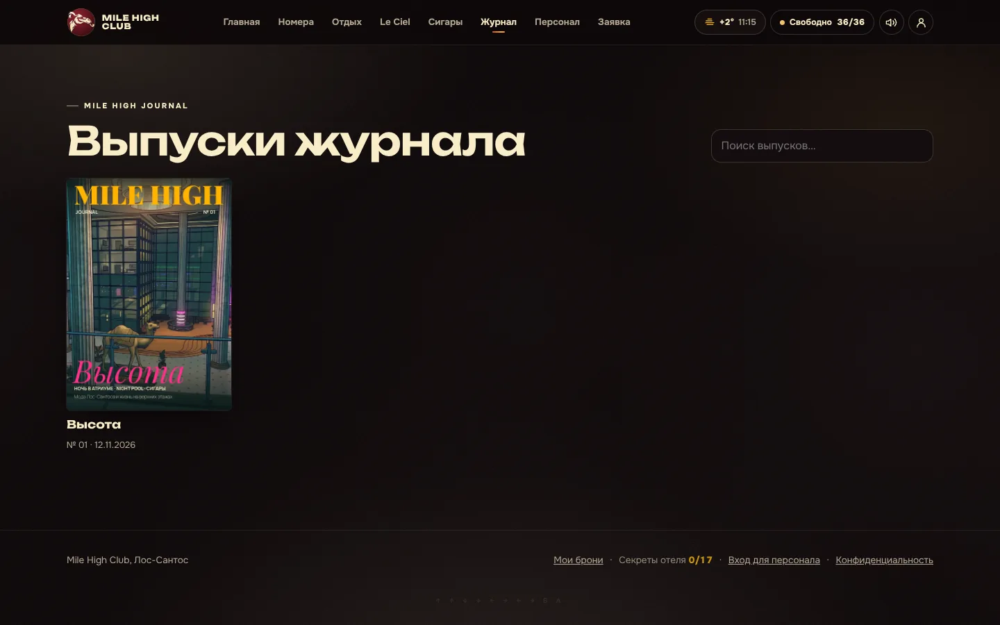
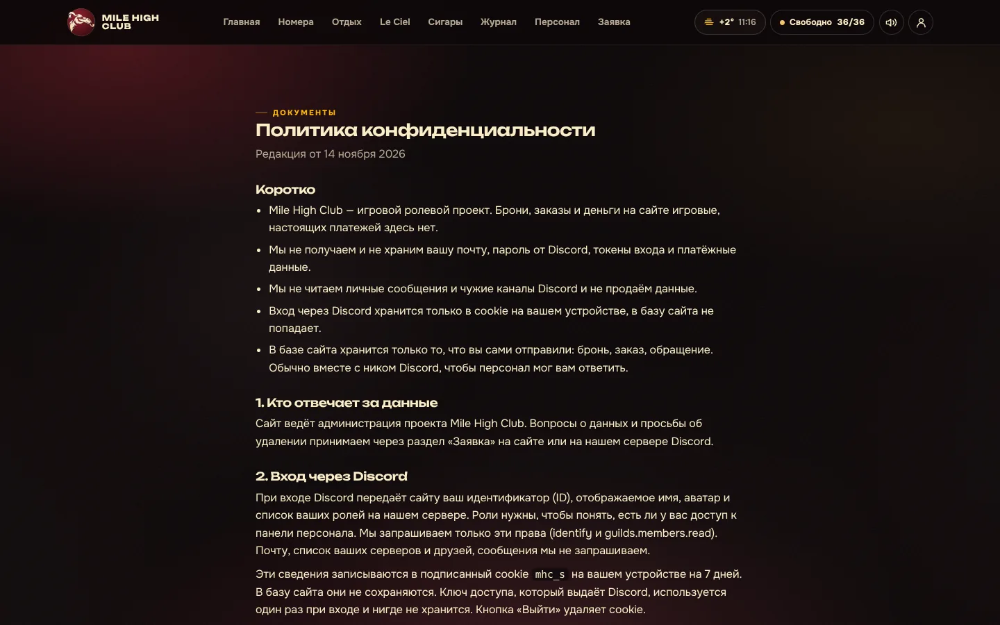
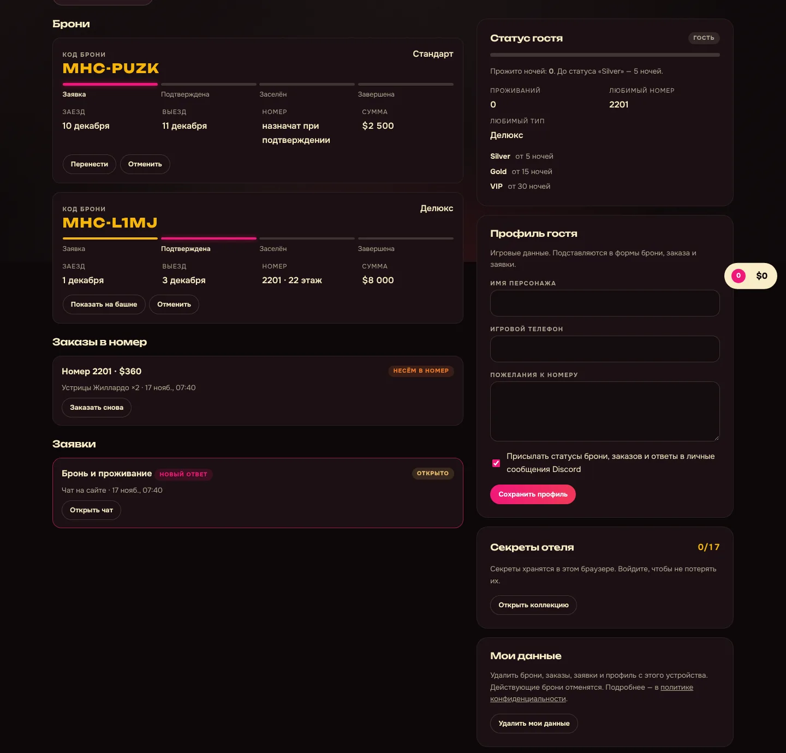
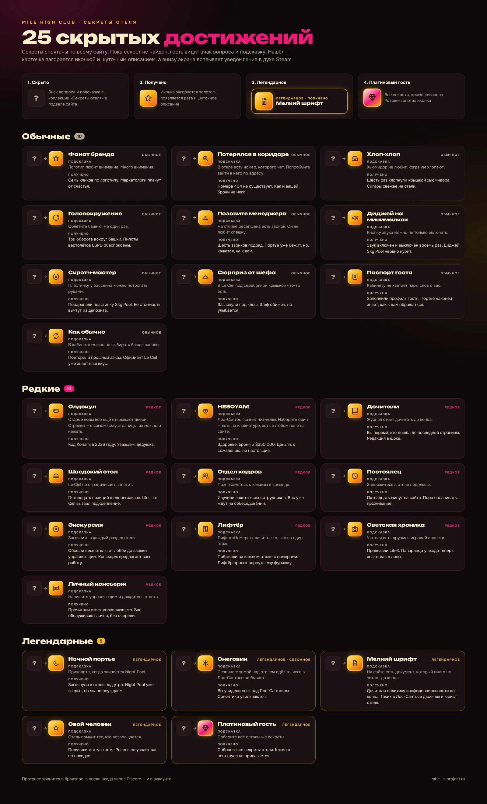
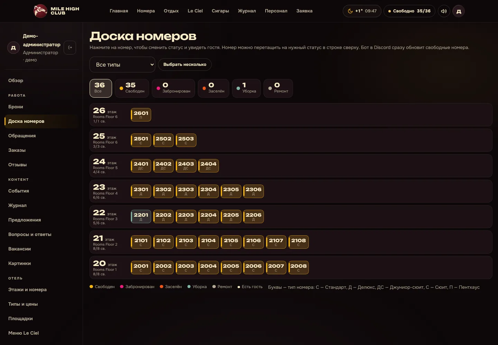
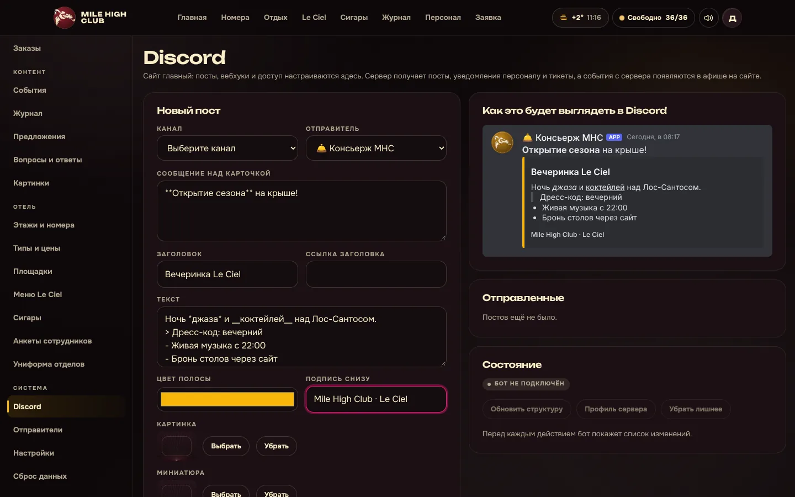

<div align="center">


# Mile High Club

**Сайт отеля над Лос-Сантосом и Discord-бот для GTA RP**

Текущая версия: **<!--ver-->v5.16.0<!--/ver-->**

Бронь номеров на 3D-башне · Le Ciel и заказ в номер · сигарный клуб · журнал · обращения с тикетами в Discord · панель персонала

[Новое](#последнее-обновление) · [Дорожная карта](#дорожная-карта) · [Возможности](#возможности) · [Панель персонала](#панель-персонала) · [Discord](#discord-бот) · [Запуск](#запуск-на-сервере)

</div>



## Последнее обновление

**v5.15.0 · Гости отеля · 24.11.2026**

- **Гостевая книга:** все, кто когда-либо жил в отеле, без живущих сейчас. Открывается пилюлей гостей в шапке, от записи можно отказаться. Страница гостя выключена, пока он сам её не откроет: имя, портрет, карта, статус, ночи и секреты.
- **Портрет гостя** с обрезкой в браузере. Администрация снимает портрет с причиной, гость получает уведомление.
- **Значки:** администрация, модерация, подтверждённый гость. Знак коллекционера растёт с каждым найденным секретом.
- **Номер комнаты конфиденциален:** на страницах гостей его нет, в кабинете он скрыт до нажатия «Показать номер».
- Секреты, выданные или снятые в панели, сразу видны у гостя.

**v5.14.0 · Вайс-Сити заново · 24.11.2026**

- **Улица Вайс-Сити:** балконы, маркизы, зонты и балюстрада, мокрая набережная с отсветами неона, луна, облака и город за улицей. Пролетают самолёты. Камера плавная, машин нет.
- **Знак подтверждённого гостя** рядом с именем в кабинете, отзывах и панели.
- Номера этажей на главной без лишних линий, удалён неиспользуемый код.

**v5.13.0 · Башня и Лос-Сантос заново, кабинет гостя · 24.11.2026**

- **«Номера»:** башня с фасадом и крышами из Blender, одна вывеска, город без краёв мира: холмы, обсерватория, океан с пирсом и колесом. Поток машин идёт по полосам и тормозит в поворотах, изредка бывает погоня с вертолётом. Дома перед отелем опускаются и не закрывают его.
- **Плавность:** камера на пружинах без рывков, окна и шлейфы не мерцают, подгрузка заранее. Спокойный режим больше не двигает шапку и подвал.
- **Кабинет гостя:** карта с номером и статусом, просьбы к отелю (уборка, будильник, машина, «Не беспокоить»), предпочтения к номеру. Всё внеролевое вынесено в блок OOC.
- **Панель, «Гости»:** администраторы видят данные гостей, правят карту, ночи и статус, ведут служебные заметки. Политика конфиденциальности обновлена.

**v5.12.1 · Улица Вайс-Сити · 24.11.2026**

- **«Номера» в Вайс-Сити — вся улица с первого экрана в 3D:** пять отелей ар-деко, пилон MILE HIGH, пальмы, фонари, кабриолет и город позади. Свет, тени и отсветы неона запечены в Blender Cycles, окна и витрины нарисованы: переплёт, шторы, комнаты, отражения. На сайте сцена рисуется без источников света и постобработки. Табличка о брони — под сценой и не закрывает отель.
- **Сдвиг влево при смене вкладок устранён:** классы посадочного талона совпадали с классами анимации перехода и на время перехода сжимали страницу.

**v5.12.0 · Витрина Вайс-Сити · 23.11.2026**

- **«Номера» в Вайс-Сити — витрина отеля.** Вместо башни и лифта — модель отеля ар-деко из Blender (`img/vice/hotel.glb`, 1,2 МБ, текстуры штукатурки и стекла): медленно поворачивается, тянется мышью или пальцем, ночью горит неон. Рядом — плашка «Номера — в Лос-Сантосе» с кнопкой обратного рейса: бронировать можно только дома.
- **Персонал заходит в Вайс-Сити всегда.** Кнопка «Перенестись в Вайс-Сити» во вкладке «Вайс-Сити» панели, а в подвале сайта рейс у персонала не пропадает.
- **Спокойное солнце.** На дневной сцене — небольшой мягкий диск без полос, на фоне страниц — едва заметное свечение.
- **Гость сам закрывает обращение** — на сайте (в чате и в списке «Мои обращения») и кнопкой в канале Discord. Персонал видит пометку «(гость)», гостю бот не пишет лишнего.
- **Вёрстка не прыгает вбок** при смене вкладок: место под полосу прокрутки занято всегда.
- **Дорожная карта больше не обрезается** — картинка растёт по высоте под список.

**v5.11.0 · Горячие туры · 22.11.2026**

- **Пасхалка «Горячие туры».** В подвале сайта турагентство отеля продаёт рейс Лос-Сантос → Вайс-Сити: посадочный талон с именем персонажа, перелёт на закатной шторке — и сайт переезжает в Майами. За рейс — секрет «Горячий тур».
- **Вайс-Сити целиком, а не фильтр.** Первый экран — новые сцены из Blender: отель ар-деко на набережной с неоновым пилоном MILE HIGH, соседние пастельные отели, пальмы, ретро-солнце; днём закат, ночью неон. Сцены разложены на планы, поэтому объёмный параллакс работает как в атриуме. Башня на вкладке «Номера» перестраивается в отель Майами: пастельная штукатурка, белые «брови» над окнами, ступенчатая корона со шпилем, неоновые рёбра, пальмы вдоль фасада, закатное небо с солнцем в полоску. Заголовки, кнопки и линия под шапкой переливаются градиентом.
- **Рейс одноразовый.** Вернулся в Лос-Сантос — кнопка пропадает, секрет остаётся.
- **Вкладка «Вайс-Сити» в панели.** Кнопку рейса можно выключить, фоны темы (первый экран днём и ночью, фон страниц) — заменить своими картинками.
- Исходники сцены: `brand/vice/vice_scene.py` (Blender) и `brand/vice/build_vice.py` (сборка планов и маски).

**v5.10.0 · Обращения и шапка · 22.11.2026**

- **IC и OOC в переписке.** У поля сообщения появился переключатель «IC / OOC»: OOC-реплики (разговор игроков вне роли) помечаются отдельно — пунктиром и меткой OOC — на сайте, в панели и в канале Discord (`[OOC] …`). В Discord OOC распознаётся по `[OOC]`, `OOC:` или двойным скобкам `(( … ))`.
- **Персонал подписывается игровым именем, а не ником Discord.** Имя задаётся в панели (поле «Игровое имя» в боковой колонке) и в профиле кабинета; им же подписываются ответы, написанные прямо в канале Discord.
- **Без имени персонажа писать в обращениях нельзя.** Вместо поля ввода — подсказка с кнопкой «Указать имя», а при попытке отправить — уведомление с кнопкой «Открыть профиль». Имя из формы обращения сразу заполняет профиль.
- **Шапка подстраивается под индикаторы.** Появились «гости в отеле», погода, колокольчик — разделы центрируются в свободном месте, потом у индикаторов прячутся подписи, потом разделы уходят в меню. Ничего не наезжает друг на друга.
- **«Спокойный режим» вместо системной настройки.** Сайт больше не выключает 3D и анимации из-за отключённых анимаций Windows; кому нужно — включает «Спокойный режим» в подвале или меню.
- **Фиксы:** выравнивание первого экрана главной, трек в настройках музыки больше не пропадает после загрузки, панель обращений в Discord восстанавливается, если её сообщение удалили, ошибки кнопок Discord видны в журнале панели.

**v5.9.3 · Башня · 19.11.2026**

- **Подсветка этажа переделана по-взрослому.** Вместо плоской обоймы — объёмная световая оболочка с френелем (ярче у кромок, прозрачнее в лоб) строго по контуру этажа: читается как свет вокруг него, а не наложенная картинка, и покрывает все видимые стороны. Плюс фокус затемнением — выбранный этаж горит ярче, остальные приглушаются.

**v5.9.2 · Башня · 19.11.2026**

- **Наглядный выбор этажа.** Вместо тонкой линии выбранный этаж обводится яркой неоновой обоймой: светящаяся «клетка» по периметру и две неоновые полосы по верху и низу этажа, с мягким пульсом. Сразу видно, какой этаж открыт.
- **Неоновая вывеска «MILE HIGH CLUB»** на правой башне — запечена в Blender (эмиссия + bloom), светится без динамического света, поэтому ПК не грузит. Здание стало живее и интереснее.
- Всё декоративное — на эмиссивных материалах (без дополнительных источников света): вкладка «Номера» не тяжелее прежнего.

**v5.9.1 · Фикс · 19.11.2026**

- **Окна зданий на вкладке «Номера» больше не бликают** на движении камеры: свет окон сводится к средней яркости, когда окно становится мельче пикселя (аналитический LOD эмиссии). Фасадный атлас города перезапечён в Blender — отдельные стили домов с утопленными окнами и мягкими откосами (мип-фильтрация убирает рябь на среднем плане).

**v5.9.0 · Обновление 7 «Понятная панель» · 19.11.2026**

- **Навигация панели с иконками:** у каждого раздела свой контурный значок (без эмодзи), категории «Работа / Контент / Отель / Система» разделены — ничего не теряется.
- **Доска номеров — размер:** переключатель «Крупно / Компактно» рядом с видом доски. Крупный режим — большие наглядные плитки, как было раньше; компактный умещает больше номеров.
- **Профиль:** клик по аватару в шапке открывает кабинет (а не сразу панель) — оттуда у персонала есть кнопка «Панель персонала».
- **LifeX:** интеграция управляется тумблером в «Настройки → Интеграция LifeX». Включение и выключение не удаляют уже привязанные профили гостей. Работает, когда на хостинге заданы ключи приложения LifeX.
- **Загрузка файлов:** снят лимит 10 МБ на файл — предельный размер определяет хостинг.
- **Оптимизация:** окна городских зданий на вкладке «Номера» больше не мерцают на движении камеры (сглаживание краёв по производным пикселя).

**v5.8.0 · Обновление 6 «Гибкая панель» · 19.11.2026**

- **Доска номеров — два вида:** переключатель «По этажам / Колонки по статусу». Первый — текущая шахматка по этажам, второй — изначальная доска-канбан: карточки номеров тянутся между колонками статусов. Выбранный вид запоминается у администратора в браузере.
- **Окошки сайта в настройках:** администратор включает и выключает погоду с температурой, счётчик гостей онлайн и окно «Свободно» в шапке. Выключенное окошко просто скрывается, данные не теряются.
- **Оптимизация:** на разделах без 3D (Le Ciel, отдых, кабинет) больше не скачивается three.js (−132 КБ), на главной атриум грузится один раз вместо двух (−329 КБ).

**v5.7.0 · Обновление 5 «Полировка» · 19.11.2026**

- **Прогрузка:** атриум главной больше не скачивается на других страницах, убраны дубли логотипа и предзагрузок — внутренние страницы легче на 40–50%.
- **Вертушка** в «Отдыхе» больше не исчезает без треков: показывает пустое состояние с подсказкой персоналу, где загрузить музыку.
- **Блюдо дня** Le Ciel назначается в панели: авто по дню, выбор из меню или своё блюдо вне меню.
- **Доска номеров:** плитки номеров заполняют строку этажа по ширине, крупнее и читаемее.
- **Шапка** не сдвигается при появлении колокольчика; заголовок «Сутки отеля» выровнен с заголовком страницы.
- **LifeX** выключен по умолчанию (включается `LIFEX_ENABLED`). Счётчик Discord показывает всего участников и онлайн.

- **Безопасность:** ревью по методологии BugHunter. Скачивание аватара LifeX теперь только с публичных хостов — закрыты внутренние адреса и облачные метаданные (SSRF).
- **Чаты и заявки в Discord:** переписка по брони и обращения в режиме «чат на сайте» дублируются в канал Discord. Персонал отвечает прямо из канала — ответ приходит гостю на сайт и в личные сообщения. Удобно тем, кто не пользуется сайтом.
- **Дизайн:** заметный фокус-ринг на любом фоне, живые строки меню (золотой акцент при наведении), мягкое поднятие карточек.

- **Чат по брони:** гость пишет отелю прямо из карточки брони в кабинете, управляющий отвечает из панели («Брони» → «Чат с гостем», с шаблонами). Ответ приходит на сайт без перезагрузки, в колокольчик и в личные сообщения Discord; сообщение гостя — в ленту персонала.
- **Путь гостя:** после брони — шаги «что дальше» и кнопка «Написать отелю»; пока ждём подтверждения — понятное пояснение; после подтверждения — золотая ключ-карта с номером и подсказкой про лифт; после заселения — «Заказать в номер», «Ресепшен», «Отдых». Смены статуса записываются в переписку и подсвечивают карточку.

- **Уведомления на сайте:** колокольчик в шапке. Бронь подтвердили, заказ несут, управляющий ответил, отзыв опубликован — всё приходит и на сайт, новое всплывает подсказкой.
- **Проверка ника Discord** прямо в форме брони: сайт подскажет, если такого участника нет на сервере, и переспросит перед отправкой.
- **Защита от спама:** не больше 3 активных броней и 2 заказов в работе на гостя, частые повторы с одного адреса отсекаются.
- **Своя музыка на вертушке:** треки mp3, ogg или m4a загружаются в настройках. YouTube больше не используется.
- **Панель:** общий поиск по коду брони, нику Discord, имени и номеру; шаблоны ответов с подстановкой имени; выгрузка броней, заказов и отзывов в таблицу Excel за период.
- **Отметка персонала в Discord:** при новом отзыве и отклике на вакансию бот отмечает выбранную роль в ленте сайта.
- **Панель на телефоне:** поиск отдельной строкой, лента разделов листается, чат обращения открывается сразу под списком.

Предыдущий, **патч 4.2 «Кабинет гостя» · 17.11.2026**

- **Брони под рукой:** карточка с кодом, датами заезда и выезда, номером и суммой, статус шагами. Неподтверждённую бронь можно перенести, а до заселения — отменить. Кнопка «Показать на башне» подсвечивает номер на 3D-фасаде.
- **Чат с управляющими** прямо в кабинете. О новом ответе подскажет колокольчик уведомлений.
- **Уведомления в Discord:** бот пишет в личку, когда бронь подтвердили, заказ несут в номер или ответили на обращение. Отключается в профиле.
- **Профиль гостя:** имя персонажа, игровой телефон и пожелания подставляются в формы сами.
- **Статус гостя:** Silver, Gold и VIP за прожитые ночи. Скидку и привилегию для каждого статуса задают в панели.
- **Заказать снова** — прошлый заказ из Le Ciel одной кнопкой.
- **Секреты отеля** сохраняются в аккаунте и не теряются при смене устройства.
- **Удалить мои данные** — одной кнопкой, как обещано в политике конфиденциальности.
- После входа через Discord всё, что оформлено с устройства, переходит в аккаунт.

Предыдущий, **патч 4.1 «Надёжность»**: сервер держит в 5 раз больше запросов, закрыты дыры безопасности, телефон не показывает пустую страницу, тикеты закрываются без ошибки.

## Отель в цифрах

| | |
|---|---|
| 🏙 **40 этажей** | башня над Лос-Сантосом |
| 🛏 **54 номера** | на 6 этажах (20–25): Стандарт, Делюкс, Джуниор-сюит. Статус каждого виден на фасаде |
| 🍽 **30 этаж** | ресторан Le Ciel |
| 🚬 **31 этаж** | сигарный клуб с 3D-хьюмидором |
| 🌙 **33 этаж** | ночной клуб Assmosphere |
| 🧖 **35 этаж** | спа, скоро открытие |
| 🏊 **38 и 40 этажи** | бассейны |
| 🗝 **25 секретов** | скрытые достижения: обычные, редкие и легендарные. Найдёте все? |
| ✅ **215 автотестов** | проверяют сайт, сервер и бота перед каждым обновлением |

## Дорожная карта


### 🛠 Сейчас в работе · Обновление 5 «Полировка»
Сайт и бот работают на `mhc-ls-project.ru` с 15.11.2026, сейчас доводим живой сайт.
- [x] Кабинет гостя с картой и просьбами к отелю, раздел «Гости» в панели
- [x] Башня, город и горизонт на «Номерах» заново
- [x] Улица Вайс-Сити: фон, детали, самолёты
- [x] Отзывы гостей с модерацией и ответом отеля
- [x] Вакансии на сайте
- [x] Сайт как приложение на телефоне и красивое превью ссылки
- [x] Доска номеров «шахматкой» в панели
- [x] Уведомления на сайте и защита от спама бронями
- [x] Проверка ника Discord в форме брони
- [x] Своя музыка на вертушке без YouTube
- [x] Убраны униформа и 3D-манекен, «Пойду» и лишняя отметка на значке кабинета
- [x] Общий поиск, шаблоны ответов и выгрузка в таблицу в панели
- [x] Отметка роли персонала при новом отзыве и отклике на вакансию
- [x] Панель персонала на телефоне
- [ ] Выкатить на сайт кабинет гостя (патч 4.2 готов в коде)
- [ ] Выкатить счётчик «Гостей в отеле» (готов в коде)
- [ ] Роли доступа в панели: «Доступ и анонсы»
- [x] Гостевая книга, портреты и значки
- [ ] Обратный отсчёт до открытия отеля на главной (нужна дата)
- [ ] «Персонал на смене» на табло: сколько сотрудников сейчас в сети (нужен интент присутствия у бота)
- [ ] Замер скорости загрузки и отчёт
- [ ] Подключить привязку LifeX: создать приложение на `lifex.ls-project.com/dev` и вписать адреса в `.env` (код готов)

### 🔭 Дальше
- [ ] LifeX: лента отеля на сайте и публикация из панели (ждём документацию API)
- [ ] Идеи игроков из Discord

<details>
<summary><b>✅ Выпущено: 7 обновлений</b> (нажмите, чтобы раскрыть)</summary>

#### Патч 4.2 · Кабинет гостя — 17.11.2026
- [x] Карточки броней: код, даты, номер, сумма, статус шагами, «Показать на башне»
- [x] Отмена брони до заселения и перенос неподтверждённой
- [x] Чат с управляющими в кабинете, отметка о новых ответах
- [x] Личные сообщения в Discord о статусах и ответах, отключаются в профиле
- [x] Профиль гостя с подстановкой в формы, «Заказать снова»
- [x] Статусы гостей со скидками и привилегиями, настраиваются в панели
- [x] Секреты отеля в аккаунте, перенос данных с устройства при входе
- [x] Удаление своих данных одной кнопкой

#### Патч 4.1 · Надёжность — 14.11.2026
- [x] Нагрузка: данные и статика из памяти, ответы 304, сервер держит в 5 раз больше запросов
- [x] Безопасность: права в редакторе, загрузка файлов, защита от запросов с чужих сайтов, порядок маршрутов
- [x] Целостность броней и обращений, ежедневные резервные копии
- [x] Телефон: страница не остаётся пустой при перезагрузке
- [x] Закрытие тикета без ошибки, выбор канала для постов
- [x] Политика конфиденциальности, предпросмотр постов в стиле Discord

#### Обновление 4 · Запуск — 15.11.2026
- [x] Сайт и бот на сервере, домен `mhc-ls-project.ru`, вход через Discord на домене
- [x] 54 номера на 6 этажах (20–25), как в лифте игры: Стандарт, Делюкс, Джуниор-сюит
- [x] Команда отеля с настоящими фото и анкетами
- [x] Площадки Assmosphere и Спа (Спа и Le Ciel — «скоро открытие»), расписания площадок
- [x] Меню Le Ciel, сигарный клуб, три пакета отеля, частые вопросы
- [x] Журнал «Высота» № 02 — спецвыпуск к открытию

#### Обновление 3 · Открытие — 04–11.11.2026
- [x] Логотип с оригинала, анимированные логотипы
- [x] Вертушка с музыкой в «Отдыхе»
- [x] Башня «Номера» как здание отеля в игре, ночное небо и подсветка
- [x] Гирлянда и новогодняя тема
- [x] Промо-ролики и трейлер открытия сайта

#### Обновление 2 · Сервер — 04.11.2026
- [x] Уровни доступа: администрация, дирекция, персонал, разработка
- [x] Тикеты с транскриптами в архив
- [x] Живая лента заявок: одна карточка на заявку
- [x] Посты с сайта через вебхуки, отправители в панели
- [x] События сервера в афише сайта
- [x] Профиль сервера, экран приветствия, очистка старой схемы

#### Обновление 1 · Vertical Noir — 03.11.2026
- [x] Новая визуальная система: цвета, шрифты, свет этажей
- [x] Переходы-лифт между разделами, быстрый загрузчик
- [x] Табло отеля, билеты событий, шахта лифта на главной
- [x] 3D-хьюмидор с фильтрами, фильтр номеров по башне, сравнение типов
- [x] Работа без WebGL, мобильная версия, микроанимации

#### Сезон 0 · Фундамент — 03.11.2026
- [x] Бронь номеров с выбором номера
- [x] Le Ciel: меню и заказ в номер
- [x] Сигарный клуб и журнал-листалка
- [x] Панель персонала, вход через Discord

</details>

Подробности по каждому пункту — в [CHANGELOG.md](CHANGELOG.md). Номер версии (вида `v5.4.0`) хранится в `package.json` и виден в подвале сайта и в панели персонала; новая версия выпускается командой `npm run release -- patch|minor|major "Название"` — она же обновляет README, CHANGELOG и дорожную карту. Картинка дорожной карты собирается из `docs/roadmap/roadmap.html` командой `node docs/roadmap/render.cjs`.

## Возможности

### Главная
Вход в атриум: картинка разложена на три плана, они двигаются за мышью и наклоном телефона без размытия. Ниже табло отеля с перекидными буквами: свободные номера, статусы площадок и время в отеле обновляются вживую. Дальше афиша событий с сервера Discord и пакеты отеля.


### Номера
3D-башня отеля в ночном городе. Этажи горят цветом статуса номеров, лифт вызывается кнопкой или кликом по этажу, выбранный номер подсвечивается прямо на фасаде. Фильтры по типу и числу гостей, сравнение типов номеров, бронь конкретного номера.



<table>
<tr>
<td width="50%"><b>Отдых</b><br>Что открыто сейчас: бассейны и площадки с расписанием по часам. События из Discord перекрывают расписание. Вертушка играет музыку по ссылке из настроек.<br><br></td>
<td width="50%"><b>Le Ciel</b><br>Меню ресторана по категориям, блюдо дня под клошем, заказ в номер. Заказ сразу приходит персоналу.<br><br></td>
</tr>
<tr>
<td><b>Сигарный клуб</b><br>3D-хьюмидор: крышка открывается, сигары листаются и крутятся мышью или пальцем. Фильтры по крепости и происхождению.<br><br></td>
<td><b>Журнал</b><br>Выпуски-листалки с настоящим перелистыванием страниц и поиском.<br><br></td>
</tr>
<tr>
<td><b>Заявка</b><br>Сайт проверяет, есть ли гость на сервере. Если есть, бот открывает приватный тикет в Discord, если нет, разговор идёт в чате на сайте. Без бота обращение не теряется.<br><br></td>
<td><b>Политика конфиденциальности</b><br>Что сайт хранит на самом деле, кто это видит и как попросить удаление. Текст сверен с кодом.<br><br></td>
</tr>
</table>

### Отзывы и вакансии
- **Отзывы гостей.** После выезда гость ставит оценку и пишет отзыв в кабинете. Управляющие публикуют его в панели и могут ответить от имени отеля. На главной — средняя оценка и лучшие отзывы.
- **Вакансии.** Открытые должности по отделам, «Откликнуться» открывает заявку с готовым текстом. Вакансии ведутся в панели.
- **Приложение на телефоне.** Сайт ставится на экран «Домой» со своим значком и открывается без адресной строки. Ссылка в Discord и Telegram приходит красивой карточкой с атриумом.

### Кабинет гостя
Брони с кодом и статусом шагами, перенос и отмена, чат с управляющими, профиль гостя с привязкой LifeX (фото становится аватаром на сайте, имя персонажа и телефон подставляются сами), статус Silver/Gold/VIP, повтор заказа, секреты отеля и удаление своих данных — всё на странице «Мои брони».



### На телефоне
Компактная шапка, нижние листы со свайпом, крупные кнопки. Сайт не остаётся пустым при перезагрузке и отдаёт видеопамять 3D-сцен при уходе со страницы.


### Мелочи, которые делают отель живым
- **Секреты отеля:** 25 скрытых достижений со всплывашкой в духе Steam — обычные, редкие, легендарные и сезонные. На телефоне коды вводятся касанием стрелок в подвале или набором в любом поле (`public/js/achievements.js`).
- **Звуки** синтезируются в браузере: колокольчик ресепшна, дерево, бумага, реверберация лобби. Файлов не нужно.
- **Переходы-лифт** между разделами, у каждого раздела свой этаж.
- **Новогодняя тема:** снег и гирлянда, которая реагирует на курсор и прокрутку.
- **Без WebGL** сайт тоже работает: атриум становится картинкой, башня — фасадом.

<details>
<summary><b>Все 25 секретов</b> — иконки, подсказки и как они меняются (нажмите, чтобы раскрыть)</summary>



</details>

## Панель персонала

Вход через Discord, права по ролям сервера. Администраторы управляют всем, модераторы работают с бронями, доской номеров, обращениями, заказами, событиями и журналом.

<table>
<tr>
<td width="50%"><b>Обзор</b><br>Свободные номера по типам, новые брони, обращения и заказы в работе, последние действия.<br><br></td>
<td width="50%"><b>Доска номеров</b><br>«Шахматка»: этажи строками, номера клетками, цвет — статус. Фильтры, карточка номера с гостем и бронью, перетаскивание и массовая смена статуса.<br><br></td>
</tr>
</table>

**Посты в Discord.** Пост собирается в панели и уходит через вебхук от имени выбранного отправителя. Предпросмотр показывает его так, как он будет выглядеть в Discord, с разметкой, полями, картинками и кнопкой.



**Работа быстрее.** Общий поиск в меню находит бронь, заказ, обращение или отзыв по коду, нику Discord, имени или номеру и подсвечивает найденное. Шаблоны ответов вставляются одной кнопкой в чат и в ответ на отзыв, `{имя}` заменяется именем гостя, список правится в настройках. Брони, заказы и отзывы выгружаются в CSV для Excel и Google Таблиц за 7 дней, 30 дней или свой период. На телефоне панель работает так же: поиск сверху, разделы лентой.

Ещё в панели: этажи и номера, типы и цены, площадки и расписание, меню, сигары, анкеты сотрудников и отделы, предложения, вопросы и ответы, картинки, отправители, настройки и сброс данных с подтверждением.

## Discord-бот

Бот работает в одном процессе с сайтом. Сайт главный, сервер Discord лёгкий.

- **Тикеты:** приватный канал на каждое обращение, ответы из панели приходят в канал и обратно. Закрывает только администрация, транскрипт уходит в архив.
- **Лента сайта:** одна живая карточка на заявку вместо потока сообщений. О новом отзыве и отклике на вакансию бот пишет отдельно и отмечает роль, выбранную в панели («Discord» → «Доступ и анонсы»).
- **Уровни доступа:** администрация, дирекция, персонал и разработка видят свои разделы.
- **События сервера** появляются в афише сайта и анонсируются.
- **Структура сервера** разворачивается и обновляется из панели, лишнее от старых схем убирается командой `npm run discord:cleanup`.

Подробная настройка: [DISCORD_SETUP.md](DISCORD_SETUP.md).

## Запуск на сервере

Нужен Node.js 20 или новее. Данные хранятся в SQLite (`data/mhc.sqlite`), загруженные картинки — в `data/uploads`, резервные копии базы — в `data/backups` (раз в сутки, последние 7).

```bash
npm install --omit=dev
cp .env.example .env   # заполните значения, SESSION_SECRET — длинная случайная строка
npm start
```

Для постоянной работы удобно запускать через pm2 (`pm2 start server/index.js --name mhc`) за nginx с HTTPS. Готовый конфиг nginx: [`deploy/nginx.conf`](deploy/nginx.conf). Он отдаёт картинки и модели с диска и не буферизует поток `/api/stream`.

После обновления кода перезапустите Node: скрипты и стили сервер держит в памяти уже сжатыми.

**LifeX.** Привязка профиля в кабинете включается, когда в `.env` заданы `LIFEX_CLIENT_ID`, `LIFEX_REDIRECT_URI` (`https://ваш-домен/auth/lifex/callback`), `LIFEX_TOKEN_URL` и `LIFEX_PROFILE_URL`. Приложение создаётся на `lifex.ls-project.com/dev`, адреса токена и профиля — в его документации. Если LifeX выдал секрет, добавьте `LIFEX_CLIENT_SECRET`.

Проверить локально без Discord: `DEMO_LOGIN=true npm run dev`, открыть http://localhost:3000 и войти кнопкой «Администратор».

### Проверки

```bash
npm run test:server    # сервер: кэш, 304, безопасность, целостность броней и обращений
npm run test:discord   # бот на имитации сервера Discord, без сети
npm run smoke          # Playwright: все разделы на компьютере, планшете и телефоне
```

## Технологии

Node.js 20, Express, SQLite (better-sqlite3), discord.js 14, three.js, page-flip. Без сборщика: браузер получает модули как есть, сервер отдаёт их заранее сжатыми (brotli, gzip) с долгим кэшем по версии.

| Папка | Что внутри |
|---|---|
| `server/` | HTTP-сервер, сессии, загрузки, бот (`bot.js`, `discord/`) |
| `public/js/core.js` | Общая логика броней, обращений, ролей. Работает и на сервере, и в демо-версии в браузере |
| `public/` | Страницы, 3D-сцены, панель персонала и картинки |
| `tests/` | Тесты сервера, бота и проверка всех разделов в браузере |
| `deploy/` | Конфиг nginx |
| `brand/`, `promo/` | Логотипы, анимации и рекламные ролики |

## Модели и картинки

- Слои атриума лежат в `public/img/layers`. Своя картинка главной из панели показывается одной плоскостью с мягким движением.

## Авторство

© 2026 babymontana. Все права защищены, подробности в [LICENSE](LICENSE).

Mile High Club — ролевой проект: в игре (IC) создатель сайта — **Louis Cruze**, реальный автор сайта и бота (OOC) — **babymontana**.
