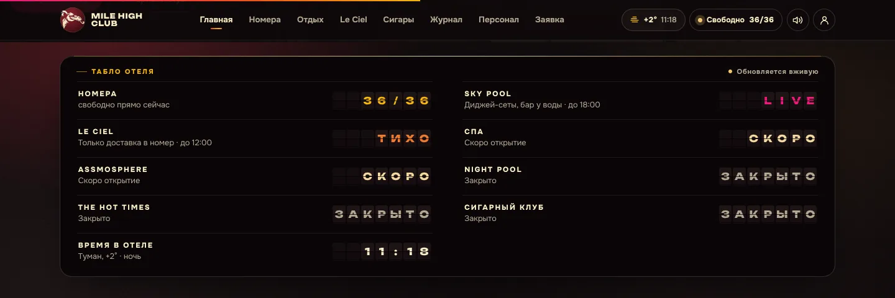
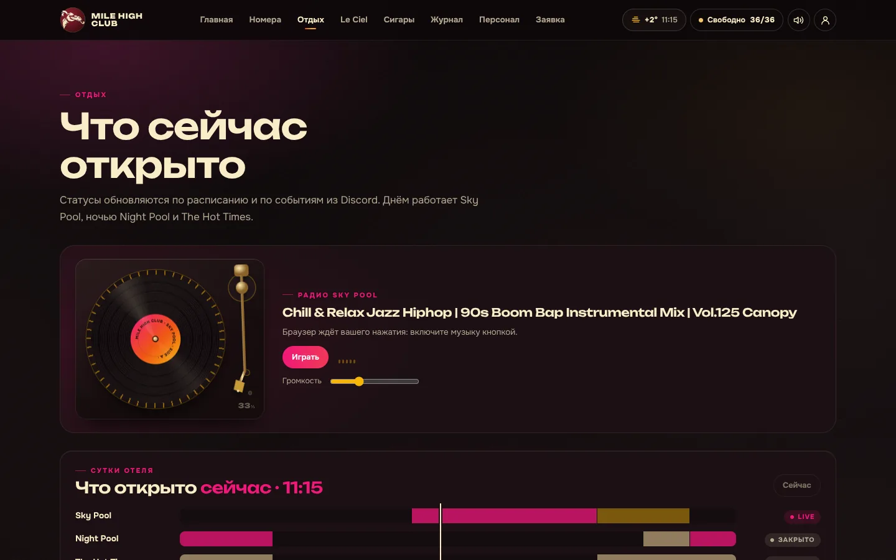
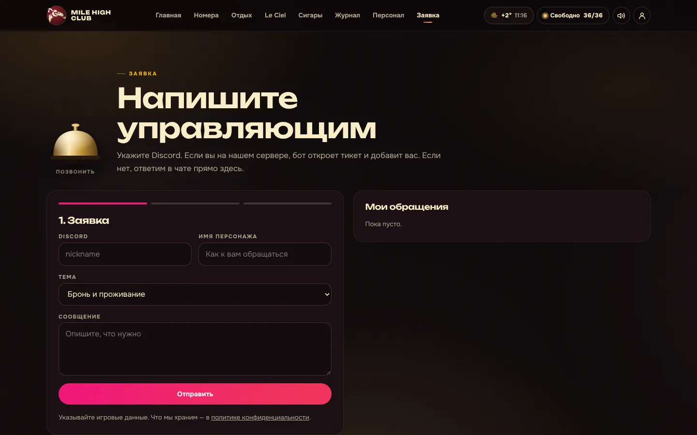
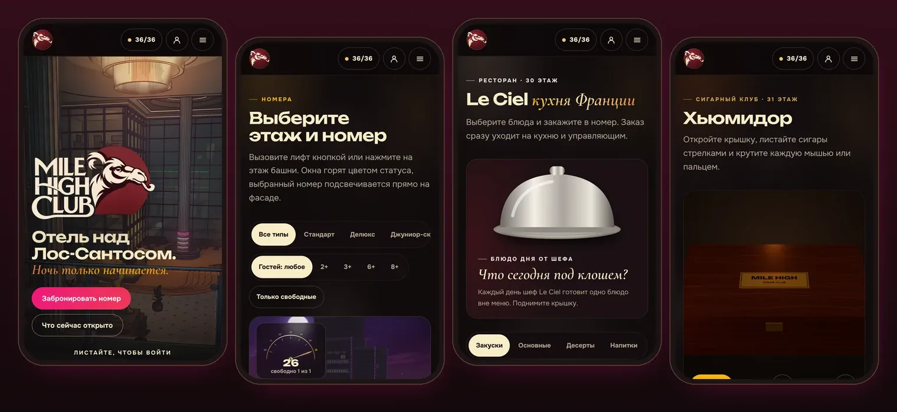
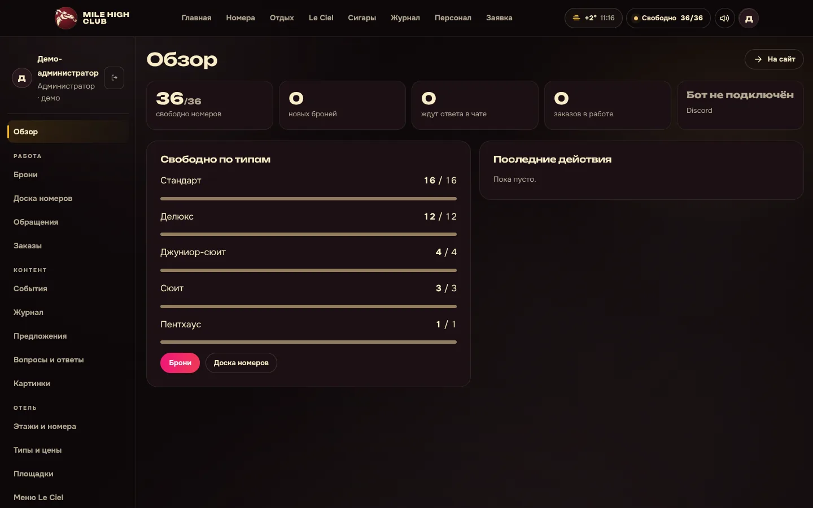
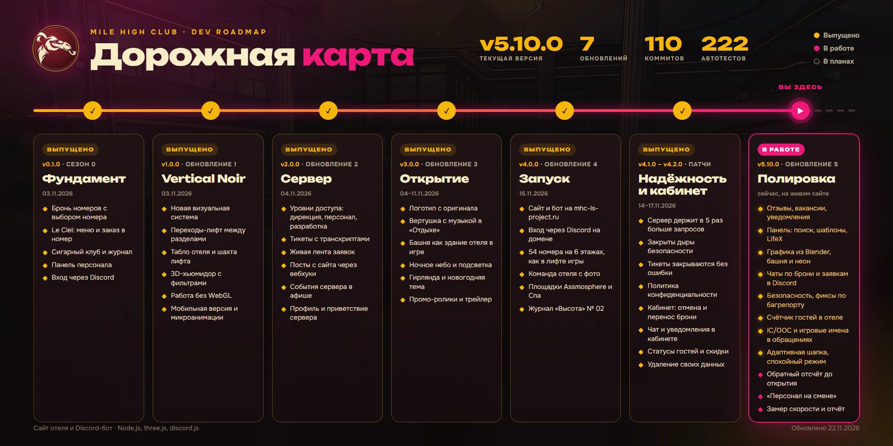

<div align="center">


# Mile High Club

**Сайт отеля над Лос-Сантосом и Discord-бот для GTA RP**

Бронь номеров на 3D-башне · Le Ciel и заказ в номер · сигарный клуб · журнал · обращения с тикетами в Discord · панель персонала

[Возможности](#возможности) · [Панель персонала](#панель-персонала) · [Discord](#discord-бот) · [Дорожная карта](#дорожная-карта) · [Запуск](#запуск-на-сервере) · [Что изменилось](CHANGELOG.md)

</div>


## Возможности

### Главная
Вход в атриум: картинка разложена на три плана, они двигаются за мышью и наклоном телефона без размытия. Ниже табло отеля с перекидными буквами: свободные номера, статусы площадок и время в отеле обновляются вживую. Дальше афиша событий с сервера Discord и пакеты отеля.



### Номера
3D-башня отеля в ночном городе. Этажи горят цветом статуса номеров, лифт вызывается кнопкой или кликом по этажу, выбранный номер подсвечивается прямо на фасаде. Фильтры по типу и числу гостей, сравнение типов номеров, бронь конкретного номера.


<table>
<tr>
<td width="50%"><b>Отдых</b><br>Что открыто сейчас: бассейны и площадки с расписанием по часам. События из Discord перекрывают расписание. Вертушка играет музыку по ссылке из настроек.<br><br></td>
<td width="50%"><b>Le Ciel</b><br>Меню ресторана по категориям, блюдо дня под клошем, заказ в номер. Заказ сразу приходит персоналу.<br><br></td>
</tr>
<tr>
<td><b>Сигарный клуб</b><br>3D-хьюмидор: крышка открывается, сигары листаются и крутятся мышью или пальцем. Фильтры по крепости и происхождению.<br><br></td>
<td><b>Журнал</b><br>Выпуски-листалки с настоящим перелистыванием страниц и поиском.<br><br></td>
</tr>
<tr>
<td><b>Заявка</b><br>Сайт проверяет, есть ли гость на сервере. Если есть, бот открывает приватный тикет в Discord, если нет, разговор идёт в чате на сайте. Без бота обращение не теряется.<br><br></td>
<td><b>Политика конфиденциальности</b><br>Что сайт хранит на самом деле, кто это видит и как попросить удаление. Текст сверен с кодом.<br><br></td>
</tr>
</table>

### На телефоне
Компактная шапка, нижние листы со свайпом, крупные кнопки. Сайт не остаётся пустым при перезагрузке и отдаёт видеопамять 3D-сцен при уходе со страницы.



### Мелочи, которые делают отель живым
- **Секреты отеля:** 17 скрытых достижений со всплывашкой в духе Steam (`public/js/achievements.js`).
- **Звуки** синтезируются в браузере: колокольчик ресепшна, дерево, бумага, реверберация лобби. Файлов не нужно.
- **Переходы-лифт** между разделами, у каждого раздела свой этаж.
- **Новогодняя тема:** снег и гирлянда, которая реагирует на курсор и прокрутку.
- **Без WebGL** сайт тоже работает: атриум становится картинкой, башня — фасадом.

## Панель персонала

Вход через Discord, права по ролям сервера. Администраторы управляют всем, модераторы работают с бронями, доской номеров, обращениями, заказами, событиями и журналом.

<table>
<tr>
<td width="50%"><b>Обзор</b><br>Свободные номера по типам, новые брони, обращения и заказы в работе, последние действия.<br><br></td>
<td width="50%"><b>Доска номеров</b><br>Номера по статусам: свободен, забронирован, заселён, уборка, ремонт.<br><br></td>
</tr>
</table>

**Посты в Discord.** Пост собирается в панели и уходит через вебхук от имени выбранного отправителя. Предпросмотр показывает его так, как он будет выглядеть в Discord, с разметкой, полями, картинками и кнопкой.


Ещё в панели: этажи и номера, типы и цены, площадки и расписание, меню, сигары, анкеты сотрудников и униформа, предложения, вопросы и ответы, картинки, отправители, настройки и сброс данных с подтверждением.

## Discord-бот

Бот работает в одном процессе с сайтом. Сайт главный, сервер Discord лёгкий.

- **Тикеты:** приватный канал на каждое обращение, ответы из панели приходят в канал и обратно. Закрывает только администрация, транскрипт уходит в архив.
- **Лента сайта:** одна живая карточка на заявку вместо потока сообщений.
- **Уровни доступа:** администрация, дирекция, персонал и разработка видят свои разделы.
- **События сервера** появляются в афише сайта и анонсируются.
- **Структура сервера** разворачивается и обновляется из панели, лишнее от старых схем убирается командой `npm run discord:cleanup`.

Подробная настройка: [DISCORD_SETUP.md](DISCORD_SETUP.md).

## Дорожная карта



Подробно, с отметками о готовности: [ROADMAP.md](ROADMAP.md). Все изменения по разделам: [CHANGELOG.md](CHANGELOG.md).

## Запуск на сервере

Нужен Node.js 20 или новее. Данные хранятся в SQLite (`data/mhc.sqlite`), загруженные картинки — в `data/uploads`, резервные копии базы — в `data/backups` (раз в сутки, последние 7).

```bash
npm install --omit=dev
cp .env.example .env   # заполните значения, SESSION_SECRET — длинная случайная строка
npm start
```

Для постоянной работы удобно запускать через pm2 (`pm2 start server/index.js --name mhc`) за nginx с HTTPS. Готовый конфиг nginx: [`deploy/nginx.conf`](deploy/nginx.conf). Он отдаёт картинки и модели с диска и не буферизует поток `/api/stream`.

После обновления кода перезапустите Node: скрипты и стили сервер держит в памяти уже сжатыми.

Проверить локально без Discord: `DEMO_LOGIN=true npm run dev`, открыть http://localhost:3000 и войти кнопкой «Администратор».

### Проверки

```bash
npm run test:server    # сервер: кэш, 304, безопасность, целостность броней и обращений
npm run test:discord   # бот на имитации сервера Discord, без сети
npm run smoke          # Playwright: все разделы на компьютере, планшете и телефоне
```

## Технологии

Node.js 20, Express, SQLite (better-sqlite3), discord.js 14, three.js, page-flip. Без сборщика: браузер получает модули как есть, сервер отдаёт их заранее сжатыми (brotli, gzip) с долгим кэшем по версии.

| Папка | Что внутри |
|---|---|
| `server/` | HTTP-сервер, сессии, загрузки, бот (`bot.js`, `discord/`) |
| `public/js/core.js` | Общая логика броней, обращений, ролей. Работает и на сервере, и в демо-версии в браузере |
| `public/` | Страницы, 3D-сцены, панель персонала, картинки и модели |
| `tests/` | Тесты сервера, бота и проверка всех разделов в браузере |
| `deploy/` | Конфиг nginx |
| `brand/`, `promo/` | Логотипы, анимации и рекламные ролики |

## Модели и картинки

- Манекены `public/models/male.glb` и `female.glb` — X Bot и Y Bot из примеров three.js (Mixamo), уменьшены, с позой ожидания. Модель формы отдела загружается в панели (`.glb`), фото вещи на 360° — серия из 24–36 кадров по кругу.
- Слои атриума лежат в `public/img/layers`. Своя картинка главной из панели показывается одной плоскостью с мягким движением.
