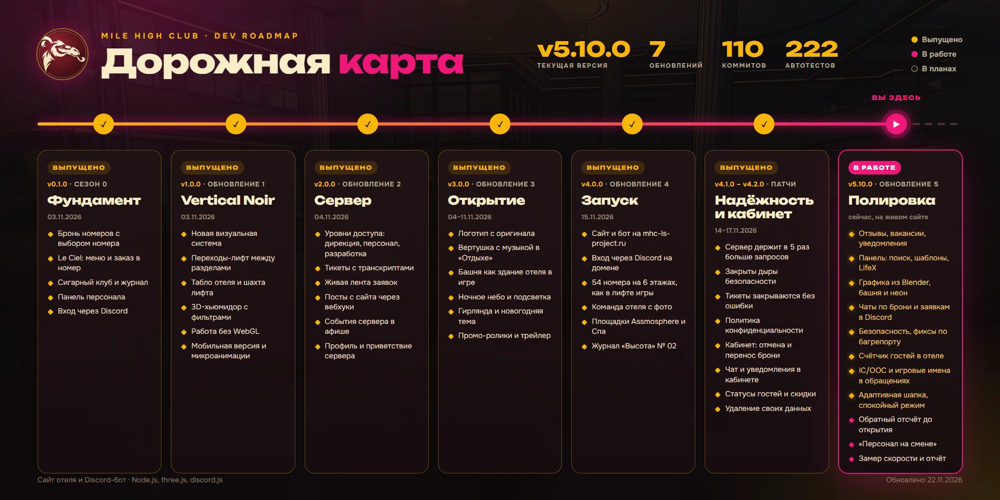

# Дорожная карта Mile High Club

✅ выпущено · 🛠 в работе · 🔭 в планах. Подробности по каждому пункту — в [CHANGELOG.md](CHANGELOG.md) и истории коммитов.

---

## ✅ Сезон 0 · Фундамент — 03.11.2026
- [x] Бронь номеров с выбором конкретного номера
- [x] Le Ciel: меню и заказ в номер
- [x] Сигарный клуб и журнал-листалка
- [x] Панель персонала
- [x] Вход через Discord, права по ролям сервера

## ✅ Обновление 1 · Vertical Noir — 03.11.2026
- [x] Новая визуальная система: цвета, шрифты, свет этажей
- [x] Переходы-лифт между разделами, доступные диалоги, быстрый загрузчик
- [x] Табло отеля, билеты событий, шахта лифта на главной
- [x] 3D-хьюмидор с фильтрами по крепости и происхождению
- [x] Фильтр номеров по башне и сравнение типов
- [x] Работа без WebGL: статичный атриум, фасад башни
- [x] Мобильная версия и микроанимации

## ✅ Обновление 2 · Сервер — 04.11.2026
- [x] Уровни доступа: администрация, дирекция, персонал, разработка
- [x] Тикеты с транскриптами в архив
- [x] Живая лента заявок: одна карточка на заявку
- [x] Посты с сайта через вебхуки, отправители в панели
- [x] События сервера в афише сайта
- [x] Профиль сервера, экран приветствия, очистка старой схемы

## ✅ Обновление 3 · Открытие — 04–11.11.2026
- [x] Логотип с оригинала, анимированные логотипы
- [x] Вертушка с музыкой в «Отдыхе»
- [x] Башня «Номера» как здание отеля в игре, ночное небо и подсветка
- [x] Гирлянда и новогодняя тема
- [x] Промо-ролики и трейлер открытия сайта

## ✅ Патч 3.1 · Надёжность — 14.11.2026
- [x] Нагрузка: данные и статика из памяти, ответы 304, сервер держит в 5 раз больше запросов
- [x] Безопасность: права в редакторе, загрузка файлов, защита от запросов с чужих сайтов, порядок маршрутов
- [x] Целостность броней и обращений, ежедневные резервные копии
- [x] Телефон: страница не остаётся пустой при перезагрузке
- [x] Закрытие тикета без ошибки `hooks.resolveRole is not a function`
- [x] Выбор канала для вебхук-постов
- [x] Политика конфиденциальности
- [x] Предпросмотр постов в стиле Discord

## 🛠 Обновление 4 · Запуск — ближайшее
- [ ] Выложить сайт и бота на сервер с Node.js, направить туда `mhc-ls-project.ru`
- [ ] Заменить `PUBLIC_URL` и `DISCORD_REDIRECT_URI`, добавить адрес в Redirects портала Discord
- [ ] Отметить роли в панели: «Доступ и анонсы»
- [ ] Заполнить площадки Assmosphere и Спа
- [ ] Сверить этажи: на сайте 7 этажей номеров, в лифте игры 6
- [ ] Удаление данных гостя по запросу (обещано в политике конфиденциальности)

## 🔭 Обновление 5 · Полировка — после запуска
- [ ] Замер скорости загрузки и отчёт
- [ ] Настоящие фото команды в анкетах
- [ ] Фото униформы на 360° вместо заглушек
- [ ] Идеи игроков из Discord
